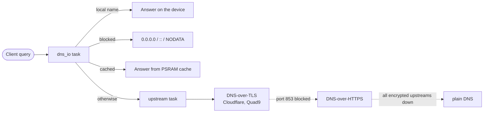

<div align="center">

# esp32-s3-adblock

**A Pi-hole on a $10 board.** Network-wide ad and tracker blocking with encrypted DNS,
running on an ESP32-S3 plugged into your router's USB port.

[](https://github.com/denzilrdz/esp32-s3-adblock/actions/workflows/build.yml)
[](https://github.com/denzilrdz/esp32-s3-adblock/releases)
[](#hardware)
[](LICENSE)

[**Install from the browser**](https://denzilrdz.github.io/esp32-s3-adblock/) ·
[Quick start](#quick-start) ·
[Router setup](docs/ROUTER_SETUP.md) ·
[How it works](#how-it-works) ·
[Architecture](docs/ARCHITECTURE.md)

</div>

---

It blocks ads, trackers and malware domains for **every device on your network**
(phones, TVs, laptops, no apps to install), sends all other lookups to Cloudflare or
Quad9 **encrypted with DNS-over-TLS** so your ISP can't read them, and **refreshes its
blocklist every night on its own**. No Raspberry Pi, no SD card, no OS to patch.

## Highlights

|                                        |                                                                                                          |
| -------------------------------------- | -------------------------------------------------------------------------------------------------------- |
| **Five-minute setup**                  | Flash from Chrome/Edge with one click, pick your Wi-Fi on your phone, point the router at it. Done.      |
| **Blocks for the whole network**       | Up to **1 million domains** in PSRAM; one entry blocks a domain and all its subdomains.                  |
| **Your ISP stops seeing your lookups** | Allowed queries leave encrypted (DNS-over-TLS, with DNS-over-HTTPS fallback), unlike a plain sinkhole.   |
| **Maintenance-free**                   | The blocklist updates itself daily; firmware updates are one button on the dashboard, with rollback.     |
| **Fast**                               | Blocklist and answer cache live in RAM: repeat lookups are answered in milliseconds.                     |
| **Dashboard**                          | `http://s3adblock.local`: live stats, clients, your own block/allow rules, pause blocking, settings.     |
| **Secure by default**                  | Password set with a one-time code from the serial console, login lockout, CSRF and DNS-rebinding guards. |
| **Tiny and cheap**                     | Powered from the router's USB port; nothing else to buy or run.                                          |

> [!NOTE]
> **Project status: early release (v0.1.4).** Tested on an ESP32-S3-DevKitC-1 (N16R8):
> Wi-Fi setup, DNS-over-TLS, blocking, the blocklist download and its "not modified"
> check, failover to Quad9 when the primary is unreachable, plain-DNS fallback on and
> off, dashboard firmware updates and automatic rollback of a bad update. Expect some
> rough edges; please [report issues](https://github.com/denzilrdz/esp32-s3-adblock/issues).

## Contents

- [How it compares](#how-it-compares)
- [Quick start](#quick-start)
- [Features](#features)
- [Hardware and requirements](#hardware)
- [How it works](#how-it-works)
- [Configuration](#configuration)
- [Updating firmware](#updating-firmware)
- [Limitations](#limitations)
- [Troubleshooting](#troubleshooting)
- [Development](#development) · [Roadmap](#roadmap) · [Support](#support) · [Credits](#credits)

## How it compares

|                       | **esp32-s3-adblock**                          | Pi-hole on a Raspberry Pi   | Original [esp32-c3-adblock](https://github.com/M-Abozaid/esp32-c3-adblock) |
| --------------------- | --------------------------------------------- | --------------------------- | -------------------------------------------------------------------------- |
| Hardware              | ESP32-S3 board, USB-powered                   | Pi + SD card + power supply | ESP32-C3 board                                                             |
| Maintenance           | none (no OS, no SD card)                      | OS updates, SD card wear    | none                                                                       |
| Upstream DNS          | **encrypted** (DoT, DoH fallback)             | plain by default            | plain UDP to 9.9.9.9                                                       |
| Blocklist             | up to 1M domains, in PSRAM                    | millions, on disk           | read from flash                                                            |
| Failed list update    | old list stays active                         | old list stays active       | can leave no list loaded                                                   |
| Answer cache          | yes (PSRAM)                                   | yes                         | no                                                                         |
| Slow upstream answer  | other queries keep flowing; SERVFAIL at 2.5 s | other queries keep flowing  | stalls every client                                                        |
| DHCP server, IPv6 DNS | not yet                                       | yes                         | no                                                                         |

## Quick start

You need an **ESP32-S3-DevKitC-1 (N16R8)** (or another board with that module), a USB
data cable, a **2.4 GHz Wi-Fi** network and **admin access to your router**.

### 1. Flash

Open the **[web installer](https://denzilrdz.github.io/esp32-s3-adblock/)** in Chrome
or Edge, plug the board in (DevKitC-1: the port marked **UART**), click _Install_.

<details>
<summary><b>Or build and flash from source</b> (macOS/Linux/Windows with PlatformIO)</summary>

```bash
git clone https://github.com/denzilrdz/esp32-s3-adblock && cd esp32-s3-adblock
cp src/secrets.example.h src/secrets.h      # optional Wi-Fi + OTA password, see comments
pio run -e esp32s3 -t upload                # flash firmware over USB
pio device monitor -e esp32s3               # watch it boot
```

Needs [PlatformIO](https://platformio.org/) (CLI or the VS Code extension) and Python
3.11+.

</details>

### 2. Connect it to Wi-Fi

On first boot the device opens an access point **`S3-AdBlock-XXXX`**. Join it from a
phone; a setup page appears. Pick your network and enter its password; the device
restarts and joins it. (Or put `WIFI_SSID`/`WIFI_PASS` in `src/secrets.h`.) Hold the
**BOOT** button while powering on to forget Wi-Fi.

### 3. Set the dashboard password

The serial console (`pio device monitor`, or the web installer's _Logs_) prints a
**one-time setup code**. Open `http://s3adblock.local` (or the device IP), log in with
user `admin` and the setup code, and set a real password (10+ characters). Until you
do, nothing can be changed, so nobody else on your network can claim the device.

### 4. Point your network at it

Give the device a fixed IP (DHCP reservation in the router), then set the router's
**DHCP DNS server** to that IP and leave the secondary DNS empty.

> [!WARNING]
> **IPv6 (Airtel and most fibre routers):** the router also advertises its own IPv6
> DNS, and devices will use it to skip the blocker. Turn off IPv6 DNS advertisement or
> IPv6 on the LAN. Airtel routers often lock the DNS fields; the guide lists
> workarounds. Full walkthrough and checks: **[docs/ROUTER_SETUP.md](docs/ROUTER_SETUP.md)**.

### 5. Check it works

From any computer on the network (replace `192.168.1.50` with the device's IP):

```console
$ dig @192.168.1.50 doubleclick.net +short
0.0.0.0
$ dig @192.168.1.50 example.com +short
<one or more real IP addresses>
```

The first name is blocked; the second gets a real answer, fetched over DNS-over-TLS.
After the router change, the dashboard's client table should fill up with your devices
and the "blocked" counter should start rising.

## Features

- **Network-wide blocking**: up to 1 million domains held in PSRAM (lookups never touch
  flash); a listed domain also blocks its subdomains; your own block and allow rules.
- **Encrypted upstream DNS**: DNS-over-TLS to Cloudflare (1.1.1.1) and Quad9
  (9.9.9.9) by fixed IP, certificates verified, TLS sessions resumed; DNS-over-HTTPS
  fallback; plain DNS only as a last resort (and you can switch that off).
- **Stays up**: health-tracked fallback chain with backoff, answers within 2.5 s or a
  clean SERVFAIL, PSRAM answer cache, watchdog on every task, automatic rollback of
  bad firmware updates, Wi-Fi supervision.
- **Self-updating blocklist**: daily at 02:00 IST (configurable). Unchanged lists aren't
  downloaded again (ETag); a bad download never replaces the working list.
- **Privacy extras**: query padding, DNSSEC "validated" flag pass-through, local
  answers for private names, and Firefox's DoH canary so Firefox keeps using it.
- **Dashboard** at `http://s3adblock.local`: live stats, upstream health, clients,
  block/allow rules, pause blocking, settings, firmware and blocklist uploads, and a
  one-click update check.
- **Secure by default**: hashed dashboard password set with a one-time code from the
  serial console, login lockout, CSRF and DNS-rebinding checks, HTTPS-only list
  downloads, LAN-only DNS answers.

<a id="hardware"></a>

## Hardware and requirements

| Board                                      | Status      | Notes                                                   |
| ------------------------------------------ | ----------- | ------------------------------------------------------- |
| **ESP32-S3-DevKitC-1, WROOM-1-N16R8**      | Supported   | 16 MB flash, 8 MB octal PSRAM.                          |
| Other ESP32-S3 boards with an N16R8 module | Should work | Needs 16 MB flash and 8 MB **octal** PSRAM (`qio_opi`). |

Only the ESP32-S3 is supported: the blocklist and DNS cache live in PSRAM, and the
partition table needs 16 MB of flash.

**Power:** any stable 5 V USB source. A router's USB port is ideal (no extra adapter).
Cheap or loose cables can brown out the board during Wi-Fi transmission; if it reboots
randomly, try another cable or charger. Keep the PCB antenna away from metal.

**You also need:**

- A USB data cable and a **2.4 GHz Wi-Fi** network.
- **Admin access to your router**, to set its DHCP DNS server (and ideally turn off
  IPv6 DNS advertisement).
- For the web installer: Chrome or Edge on a computer. To build from source:
  [PlatformIO](https://platformio.org/) (CLI or the VS Code extension) and Python 3.11+.

## How it works



**Blocking.** Domains are stored as 48-bit hashes in a bucketed index (65,536 buckets).
For `a.b.ads.example.com` the device checks the name and each parent down to
`example.com`, so one list entry blocks a whole subtree. Your allowlist wins over
everything, then your custom blocklist, then the main list. Blocked `A` queries get
`0.0.0.0`, `AAAA` gets `::`, and anything else (including the `HTTPS` records modern
browsers ask for) gets an empty answer, never NXDOMAIN.

**Encrypted DNS.** Allowed queries go to Cloudflare or Quad9 over DNS-over-TLS (port
853), connecting by IP and verifying the provider's certificate name, so no plaintext
lookup is needed to find the resolver. Airtel then sees only an encrypted connection to
1.1.1.1 or 9.9.9.9, not the names you look up. You do trust Cloudflare or Quad9 with
those names instead (pick the order on the dashboard). If port 853 is blocked the
device uses DNS-over-HTTPS (port 443). Only when every encrypted upstream is down does
it fall back to plain DNS, and it says so loudly in the log and on the dashboard.
Why not run a full recursive resolver like Unbound on the chip? See
[ARCHITECTURE.md §13](docs/ARCHITECTURE.md#13-is-an-unbound-style-recursive-resolver-feasible-here):
it's slow on this CPU and would actually show the ISP _more_.

**Cache.** Answers are cached in PSRAM with their real TTLs, so repeat lookups are
answered locally in milliseconds.

**Daily update.** At 02:00 IST (plus a few random minutes), once the clock is synced
over NTP, the device fetches the list over verified HTTPS. A list is only installed
after its header, size, checksum and ordering check out; otherwise the current list
stays and it retries hourly. The default list (StevenBlack + Hagezi Light, about
100k domains, social and messaging apps keep working) is rebuilt daily at 00:17 IST by
this repository's CI, so boards always pick up a fresh one, and published at
`https://github.com/denzilrdz/esp32-s3-adblock/releases/download/blocklist/blocklist.bin`.
If the sources didn't change, the file isn't re-uploaded and boards skip the download.

Design details, memory budget and threading: [docs/ARCHITECTURE.md](docs/ARCHITECTURE.md).

## Configuration

Everything is on the dashboard (stored in flash/NVS, survives updates):

| Setting                                                                           | Default                                                    |
| --------------------------------------------------------------------------------- | ---------------------------------------------------------- |
| Primary / secondary upstream                                                      | Cloudflare / Quad9 (or a custom DoT server: IP + TLS name) |
| DoH fallback / plain-DNS fallback                                                 | on / on                                                    |
| Query padding, DNSSEC AD pass-through                                             | on                                                         |
| Blocked answer TTL                                                                | 10 s                                                       |
| Firefox DoH canary / iCloud Private Relay opt-out / local private reverse lookups | on / off / on                                              |
| Blocklist URL and daily update time                                               | this repo's daily list, 02:00                              |
| Time zone                                                                         | `IST-5:30` (POSIX TZ string, e.g. `UTC0`)                  |
| Custom block / allow rules, banned clients, pause                                 |                                                            |

`src/secrets.h` only holds first-boot defaults (Wi-Fi, initial dashboard password, the
network OTA password). It is gitignored.

### Your own blocklist

```bash
python3 tools/build_blocklist.py my.bin                       # default sources
python3 tools/build_blocklist.py my.bin hosts.txt https://...  # hosts files, domain lists, AdGuard ||rules^
```

Upload `my.bin` on the dashboard, or host it on HTTPS and set it as the list URL. For a
bigger list, Hagezi's `pro-onlydomains.txt` (~370k) fits easily on the S3.

## Updating firmware

- **Check for updates (v0.1.2 and later):** _Device → Check for updates_. If a newer
  release exists, **Download & flash** fetches it into the browser from this project's
  GitHub Pages site and installs it through the normal upload. Settings, Wi-Fi and the
  blocklist are kept. Forks: build with `-DUPDATE_BASE_URL=\"https://<you>.github.io/<repo>/\"`.
- **Dashboard:** _Device → Flash firmware_ with **`firmware-esp32s3-vX.Y.Z.bin`** from a
  [release](https://github.com/denzilrdz/esp32-s3-adblock/releases) (not the larger
  `factory-…` image, which is for first installs; the board rejects it). Settings, Wi-Fi
  and the blocklist are kept. v0.1.0 can't update itself this way: install v0.1.1 or
  later over USB once (see the [changelog](CHANGELOG.md)).
- **Over the network:** set `OTA_PASS` (10+ characters) in `secrets.h`, then
  `pio run -e esp32s3 -t upload --upload-port s3adblock.local --upload-protocol espota --upload-flags="--auth=<OTA_PASS>"`.

New firmware has to prove itself (Wi-Fi up, DNS running for a minute). If it crashes
or doesn't get there within 5 minutes, the device rolls back to the previous version.

## Limitations

- **YouTube and similar ads** come from the same domains as the videos: DNS can't
  block them without breaking the site.
- **IPv6 DNS from the router** and **browser/OS secure DNS** (Firefox DoH set by hand,
  Chrome custom secure DNS, Android Private DNS, iCloud Private Relay) bypass any DNS
  blocker. See [docs/ROUTER_SETUP.md](docs/ROUTER_SETUP.md).
- **Devices with hard-coded DNS** (some TVs) need a router firewall rule.
- **The dashboard is plain HTTP** with Basic Auth: fine on a home LAN you trust, not
  on a shared network.
- **No DHCP server** (yet): your router must hand out the device as DNS.
- DNS is served over IPv4 only.

## Troubleshooting

| Symptom                                | Fix                                                                                                                                                |
| -------------------------------------- | -------------------------------------------------------------------------------------------------------------------------------------------------- |
| Ads still show on some devices         | They use another DNS (IPv6, private DNS, hard-coded). Check the client table and [ROUTER_SETUP.md §6](docs/ROUTER_SETUP.md#6-check-that-it-works). |
| Dashboard says **PLAIN DNS**           | Ports 853 and 443 to 1.1.1.1/9.9.9.9 fail from your network. Check with `kdig @1.1.1.1 +tls example.com` from a computer.                          |
| "clock not synced" stays               | NTP (UDP 123) to 162.159.200.1 / pool.ntp.org is blocked; the daily update waits for the clock.                                                    |
| Blocklist "invalid list"               | The URL isn't a format-v2 file (`tools/build_blocklist.py` output), or the download was cut off. The old list stays active.                        |
| Can't log in, "too many failed logins" | Wait (30 s to 5 min) or use another device. Forgot the password: erase flash (`pio run -e esp32s3 -t erase`) and flash again.                      |
| Board boot-loops after flashing        | Wrong memory type: N16R8 must use `qio_opi` (the `esp32s3` env does).                                                                              |
| Random reboots                         | Power: try another USB cable/port. Check the reset reason in the boot log.                                                                         |

More (serial logs, crash decoding, memory):
[.claude/skills/debugging/SKILL.md](.claude/skills/debugging/SKILL.md).

## Development

```bash
tools/setup-dev.sh        # pinned tools in .venv (uv) + git hooks
pio test -e native        # unit tests on your computer, with sanitizers
tools/coverage.sh         # coverage report
tools/format.sh; tools/lint.sh
```

Contributions are welcome: see [CONTRIBUTING.md](CONTRIBUTING.md) and the
[Code of Conduct](CODE_OF_CONDUCT.md). Changes are listed in
[CHANGELOG.md](CHANGELOG.md).

## Roadmap

Planned (details in [ARCHITECTURE.md §15](docs/ARCHITECTURE.md#15-platform-notes-and-roadmap)):
signed firmware images, DNS over IPv6, an optional DHCP server, and certificate date
checks.

## Support

- **Questions and bugs:** [open an issue](https://github.com/denzilrdz/esp32-s3-adblock/issues/new/choose).
  Include the boot log from the serial console and your firmware version.
- **Security problems:** please don't open a public issue. Report them privately as
  described in [SECURITY.md](SECURITY.md).

## Credits

- [M-Abozaid/esp32-c3-adblock](https://github.com/M-Abozaid/esp32-c3-adblock) by zed:
  the original hash-in-flash blocker this project is built on (MIT).
- [s60sc/ESP32_AdBlocker](https://github.com/s60sc/ESP32_AdBlocker): the original
  "answer 0.0.0.0 on an ESP32" idea (ideas only; no code used).
- Blocklists: [StevenBlack/hosts](https://github.com/StevenBlack/hosts) and
  [Hagezi DNS blocklists](https://github.com/hagezi/dns-blocklists).
- [ESP Web Tools](https://github.com/esphome/esp-web-tools) for the browser installer.

## License

MIT. See [LICENSE](LICENSE) (original copyright retained).

<div align="center">

<sub>If it blocks something it shouldn't, add it to the allowlist on the dashboard, or
<a href="https://github.com/denzilrdz/esp32-s3-adblock/issues">tell us</a> so the default list improves.</sub>

</div>
