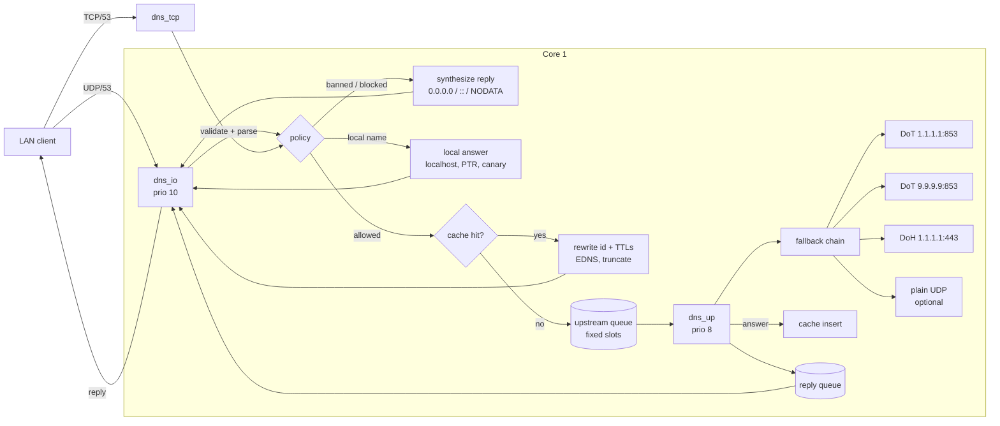
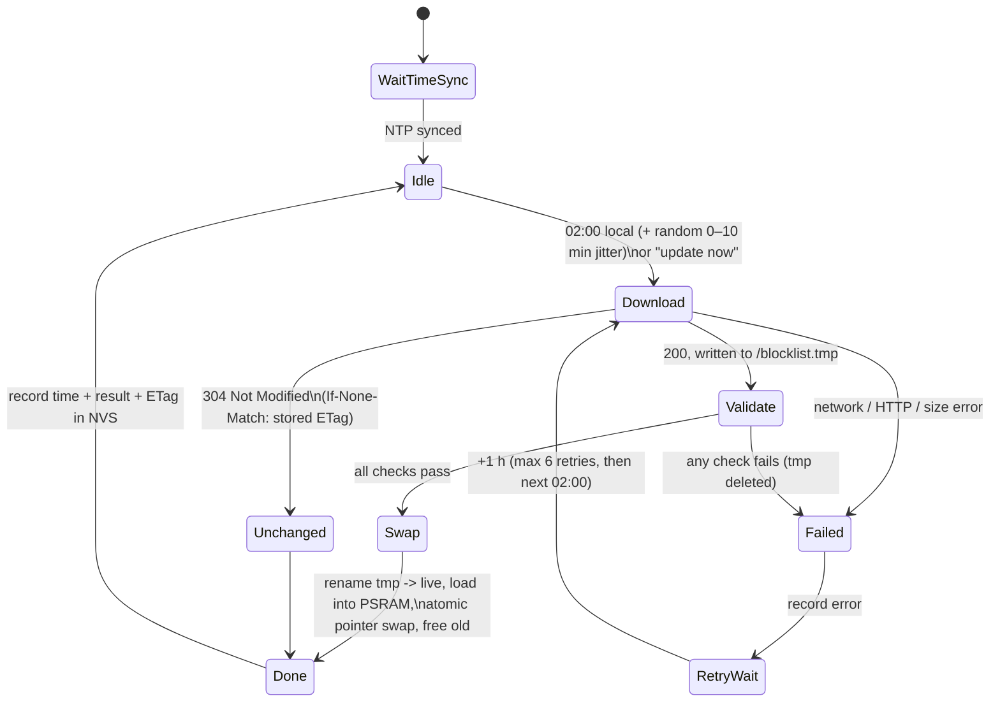
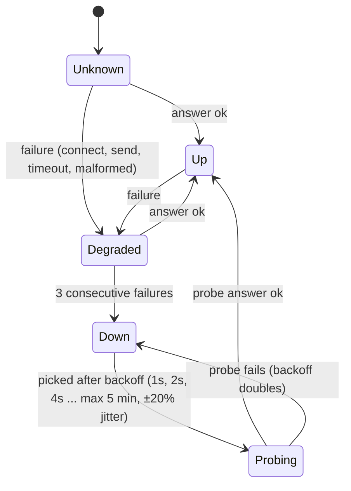

# Architecture

This document describes the design of **esp32-s3-adblock**, a Pi-hole-style DNS
sinkhole for the ESP32-S3 (WROOM-1-N16R8: 16 MB flash, 8 MB octal PSRAM). It is a
fork of [M-Abozaid/esp32-c3-adblock](https://github.com/M-Abozaid/esp32-c3-adblock)
(MIT). Read it before changing anything in `lib/core/` or `src/tasks/`.

Status: **implemented in v0.1.1, running on an ESP32-S3-DevKitC-1 (N16R8).** Items
marked *(verify on hardware)* are confirmed against the toolchain and SDK sources but
not yet measured on the board.

---

## 1. Goals and non-goals

**Goals**

1. Block ads/trackers for the whole LAN by answering blocked names locally.
2. Hide DNS query names from the ISP (Airtel) by sending all upstream traffic over
   DNS-over-TLS (DoT), with DNS-over-HTTPS (DoH) as a fallback.
3. Never break the internet: a dead upstream, a bad blocklist, or a reboot must
   degrade gracefully, not stop name resolution.
4. Keep the blocklist current without user action (daily at 02:00 IST).
5. Keep core logic testable on a Mac without hardware.

**Non-goals**

- Full recursive resolution / local DNSSEC validation (see §11).
- Blocking ads served from the same domain as content (e.g. YouTube video ads).
- DHCP server (possible later; not in this release).
- TLS on the dashboard (no realistic budget; see §9).

---

## 2. What we keep, fix, and borrow

### From upstream (esp32-c3-adblock) — keep

- Truncated FNV-1a hashes of domains instead of strings (compact, no per-entry
  allocation, deterministic).
- Parent-domain matching: a listed `ads.example.com` also blocks `x.ads.example.com`.
- Captive-portal Wi-Fi provisioning, BOOT-held-at-power-on reset, mDNS name.
- Dashboard auth model (Basic Auth + custom-header CSRF guard) and HTML escaping.
- Upstream reply matching from issue #10 (random txid, match txid + question +
  source, restore client txid).
- The weekly CI blocklist build (`tools/build_blocklist.py`), extended.

### Upstream weak points we fix

| # | Weak point (upstream `src/main.cpp`) | Fix here |
|---|---|---|
| W1 | `forwardUpstream()` blocks the single `loop()` for up to 1 s per query; one slow answer stalls every client, the dashboard and OTA (#40). | Separate DNS I/O and upstream tasks with a queue; pipelined DoT with an in-flight table (§4). |
| W2 | `beginBlocklistSwap()` deletes the live list **before** the new one is downloaded/validated; a failed update leaves no blocking (#21). | Download to a temp file, validate, then atomic swap; old list stays live on any failure (§6). |
| W3 | Blocklist validation is `size % 5 == 0` only (#20). | Versioned header, CRC-32, count/size and sortedness checks (§6.2). |
| W4 | Remote fetch uses `setInsecure()`. | Certificate verification with the ESP-IDF CA bundle. |
| W5 | Remote fetch runs inside `loop()`, freezing DNS for the whole download. | Runs in the low-priority maintenance task. |
| W6 | `MAX_RANGE = 256` clamp in `inFlash()` silently produces **false negatives** once buckets exceed 256 entries (≈1M+ hashes). Harmless on 4 MB, a real bug at S3 scale. | New bucketed index with exact bucket bounds (§6.1). |
| W7 | No response cache; every allowed query goes upstream. | TTL-respecting LRU cache in PSRAM (§5). |
| W8 | Upstream timeout → client gets **no reply**. | SERVFAIL after the deadline so clients retry promptly. |
| W9 | No query validation (QR/opcode/QDCOUNT/class); EDNS dropped from blocked replies; non-A types get an empty answer; no TCP. | Full validation, EDNS0, AAAA → `::`, NODATA+SOA for other types, TC + TCP/53 (§5). |
| W10 | Plain UDP to hard-coded 9.9.9.9:53. | Configurable DoT/DoH/UDP chain with health tracking (§4). |
| W11 | Firmware OTA has no signature check. | Optional ECDSA-P256 signed images + app rollback (§9). |

### Borrowed as *ideas only* from s60sc/ESP32_AdBlocker (AGPL-3.0 — no code copied)

- Daily update at a fixed local time driven by NTP.
- Persist the last good list in flash so boot does not need the network.
- Keep the old list when an update fails (their issue #20: a failed update took the
  whole network's DNS down).
- A "check this domain" tool on the dashboard.
- Local handling of `localhost` / private reverse zones instead of leaking them.

What we deliberately do **not** take from it: exact-match-only lookups, O(n²)
sorted inserts, answers rebuilt with a fixed 60 s TTL, single-threaded forwarding,
and forced weekly reboots.

---

## 3. Module breakdown

The code is split into a **portable core** (no Arduino or ESP-IDF headers; builds
and runs under `pio test -e native`) and a thin **platform layer** that implements
the core's interfaces on the ESP32.

```
lib/core/                     portable C++17, unit-tested natively (pio test -e native)
  dns/        message.{h,cpp}     parse/validate queries, build replies, EDNS0,
                                  truncation, blocked/NODATA/SERVFAIL synthesis
              name.{h,cpp}        wire-name parsing/compare, bounds-checked
              local_zones.{h,cpp} localhost, private reverse zones, canary domains
              query_policy.h      IQueryPolicy: forward / block / ban
  blocklist/  hash.h              FNV-1a 64 -> 48-bit domain hash
              format.{h,cpp}      v2 header, streaming + full-file validation, CRC
              index.{h,cpp}       MemoryIndex, FileIndex, IndexHolder (lock-free swap)
              matcher.{h,cpp}     custom allow/block sets + parent-domain matching
  cache/      response_cache.{h,cpp}  fixed-pool LRU + TTL, slab payloads
  upstream/   transport.h         ITransport (strategy interface)
              framing.{h,cpp}     DoT 2-byte length framing, DoH HTTP/1.1 codec
              health.{h,cpp}      per-upstream health state machine
              forwarder.{h,cpp}   ordered fallback chain, in-flight table, hedging
  sched/      daily_scheduler.{h,cpp}  02:00 local trigger, retry, dedupe
  update/     updater.{h,cpp}     download -> validate -> swap, boot recovery
  config/     config.{h,cpp}      settings, validation, NVS, upstream chain builder
  auth/       auth.{h,cpp}        password hashing, setup code, lockout, Host/Origin
  hal/        clock.h, random.h, kv_store.h, file_system.h, http_client.h,
              logger.h            hardware-abstraction interfaces
  util/       crc32, sha256 (+HMAC, PBKDF2), civil_time, bytes

src/                          ESP32 only (Arduino core 3.3.12 / ESP-IDF 5.5)
  main.cpp                    composition root: builds objects, injects
                              dependencies, starts tasks
  platform/   esp_clock.h, esp_random.h, serial_logger.h, rtos.h (Mutex),
              psram.h, littlefs_fs.h, nvs_kv_store.h, esp_http.* (HTTPS client),
              tls_stream.* (mbedTLS + lwIP), transports.* (DoT, DoH, UDP)
  tasks/      dns_service.*       dns_io, dns_tcp and dns_up tasks
  app/        blocklist_manager.* list install/update, rules, status
              clients.*           client table, bans, pause, MAC lookups
              app_policy.h        the DNS policy used by the tasks
  web/        dashboard.*         REST API + security checks
              page.h              dashboard page
              portal.*            Wi-Fi setup access point

test/                         Unity tests, one folder per area (test_dns, ...)
  fakes/                      FakeClock, FakeRandom, FakeTransport, FakeHttpClient,
                              MemFileSystem, MemKvStore, packet/list builders
tools/                        build_blocklist.py (+ tests), make_factory.sh,
                              setup-dev.sh, format.sh, lint.sh, coverage.sh
installer/                    browser installer page (deployed by release CI)
```

`lib/core` must never include `Arduino.h`, FreeRTOS, lwIP or ESP-IDF headers. CI
enforces this by building it in the `native` environment.

---

## 4. Data flow and tasks

### 4.1 Query path



1. `dns_io` owns the UDP/53 socket. It waits in `select()` on that socket and
   on a loopback "wake" socket (self-pipe pattern), so it sleeps until there is
   work and never polls.
2. Each datagram is validated (§5.1). Invalid → FORMERR/NOTIMP/drop.
3. The **policy** decides: banned client, blocking paused, allowlist, custom
   blocklist, main blocklist, local names.
4. Blocked/local replies are built in place and sent immediately.
5. Allowed names are looked up in the **response cache**. Hits are served
   immediately with the client's id, decremented TTLs and fresh EDNS.
6. Misses are copied into a fixed slot of the **query pool** and the slot index is
   posted to the **upstream queue**. `dns_io` returns to `select()` at once.
7. `dns_up` drains the queue, sends queries through the active transport
   (pipelined on DoT), matches replies via the **in-flight table**, inserts into the
   cache and posts the finished reply slot to the **reply queue**, then writes one
   byte to the wake socket.
8. `dns_io` sends the reply from the UDP/53 socket (the only task that touches
   it — lwIP is built without `LWIP_NETCONN_FULLDUPLEX`, so a socket must not be
   used from two tasks at once).

Why a hand-off at all: the prebuilt lwIP has `CONFIG_LWIP_UDP_RECVMBOX_SIZE = 6`,
so a UDP socket buffers only six datagrams. Anything that blocks the receiver
(a TLS handshake, a 300 ms upstream RTT) drops bursts. The receiver must only ever
do microsecond work.

### 4.2 Task layout

| Task | Core | Prio | Stack | Watchdog | Role |
|---|---|---|---|---|---|
| lwIP `tcpip` / Wi-Fi (IDF) | 0 | 18 / 23 | IDF | — | network stack |
| `dns_io` | 1 | 10 | 6 KB | yes | UDP/53 receive, policy, cache, replies |
| `dns_up` | 1 | 8 | 12 KB | yes | transports, chain, health, cache insert |
| `dns_tcp` | 0 | 5 | 6 KB | yes | TCP/53, ≤ 2 connections, 10 s idle (PSRAM boards only) |
| `web` | 0 | 3 | 8 KB | yes | dashboard, REST API, ArduinoOTA |
| maintenance (Arduino `loopTask`) | 1 | 1 | 16 KB | yes | Wi-Fi supervision, scheduler, blocklist update (HTTPS), MAC lookups, resolver re-pointing, OTA health mark |

The DNS tasks are named `dns_io` and `dns_up` in code (`src/tasks/dns_service.*`).
MAC addresses for the client table are read from the ARP table inside lwIP's own
thread (`tcpip_callback`), never from the DNS task.

- DNS work is pinned to **core 1**, away from Wi-Fi/lwIP on core 0, and runs above
  everything we own. It stays well below `tcpip` (18) so it can never starve the
  network stack.
- The updater does long blocking HTTP and flash writes, so it lives in the
  lowest-priority task.
- **Flash writes stall both cores** (the cache is disabled during SPI-flash erase
  and program), and PSRAM is reached through the same cache. DNS therefore pauses
  for milliseconds during blocklist and NVS writes. Writes are chunked so no
  single stall is long.

### 4.3 Watchdog

The IDF already starts the task watchdog (TWDT) with `CONFIG_ESP_TASK_WDT_TIMEOUT_S = 5`,
panic on, watching IDLE0. We do **not** call `esp_task_wdt_init()` again. Each of
our tasks calls `esp_task_wdt_add(NULL)` and `esp_task_wdt_reset()` once per loop
iteration (`esp_task_wdt_add(NULL)` keeps the same signature in IDF 5). Every blocking call in a
watched task has a timeout below 5 s; the updater resets the watchdog after each
downloaded chunk, and long blocklist validations feed it through a progress callback.
The 5 s timeout is kept as is. Shared code (TLS, HTTP, the blocklist load during
`setup()`) feeds it through `platform::feedWatchdog()`, which skips tasks that are not
subscribed: ESP-IDF 5 logs an error for those. Dashboard uploads run inside a single
`handleClient()` call and feed it for every chunk received.

---

## 5. DNS message handling

### 5.1 Validation of client queries

- Shorter than 12 bytes, or QR = 1: drop silently (prevents reflection loops).
- OPCODE ≠ QUERY → NOTIMP. QDCOUNT ≠ 1 → FORMERR.
- Question name: labels ≤ 63, name ≤ 255, no compression pointers in the question,
  stays inside the packet → otherwise FORMERR.
- QCLASS ≠ IN → REFUSED (also covers `version.bind` CHAOS probes).
- At most one OPT RR in the additional section. A malformed OPT → FORMERR. An OPT
  with version > 0 → BADVERS.

### 5.2 Blocked replies

Modelled on Pi-hole's `NULL` mode and AdGuard Home's `null_ip` mode:

| Query type | Reply |
|---|---|
| A | NOERROR, one A record `0.0.0.0`, TTL = `blocked_ttl` (default 10 s) |
| AAAA | NOERROR, one AAAA record `::` |
| HTTPS (65), SVCB (64), any other type | NOERROR with **no answer (NODATA)** plus a synthetic SOA in the authority section, so clients cache the negative answer for `blocked_ttl` |
| ANY | NOTIMP (RFC 8482 permits a minimal reply; no amplification) |

All blocked and local replies use RA = 1, AA = 0 and AD = 0, copy RD and the ID,
and echo the question.

**Why not NXDOMAIN?** RFC 8020 lets resolvers treat NXDOMAIN as "nothing exists
below this name", which can poison unrelated subdomains. NODATA is also what
AdGuard Home returns for HTTPS records. Answering HTTPS/SVCB with NODATA matters
because modern browsers query them first, and a real HTTPS record could carry
ECH or `ipv4hint` addresses that bypass the A-record block.

When the query carried an OPT RR, the reply carries one too: payload size 1232, the
client's DO bit echoed, and an **Extended DNS Error** option (RFC 8914) with code
15 "Blocked" (17 "Filtered" for a banned client). Clients that do not understand
EDE ignore it.

### 5.3 EDNS0 (RFC 6891)

OPT is hop-by-hop. We strip it from upstream answers before caching. On every
reply we build our own: advertised UDP size 1232 (DNS Flag Day 2020), the client's
DO bit echoed, and the extended RCODE recomputed. Upstream queries carry our own OPT
(size 1232, plus padding — see §5.6).

### 5.4 Truncation and TCP

- UDP reply limit = the client's OPT size clamped to [512, 1232], or 512 without
  EDNS.
- If an answer exceeds the limit, we send header + question + OPT with **TC = 1**
  and empty sections (RFC 2181 §9, RFC 6891 §7). The client retries over TCP.
- `dns_tcp` serves TCP/53 (RFC 7766 says resolvers MUST support TCP) with 2-byte
  length framing, at most 2 concurrent connections (socket budget, §11) and a 10 s
  idle timeout. It uses the same pipeline, cache and upstream queue as UDP.
- Upstream DoT/DoH answers are never truncated (stream transports), so we always
  hold the full answer to cache.

### 5.5 Local answers (no upstream leak)

- `localhost.` and `*.localhost.` → `127.0.0.1` / `::1`.
- Reverse lookups for RFC 1918/6303 private ranges (`10.in-addr.arpa`,
  `168.192.in-addr.arpa`, ...) → NXDOMAIN locally. Optionally they can go to the
  router instead, for local hostnames.
- `use-application-dns.net` → NXDOMAIN. This is Firefox's canary domain; it tells
  Firefox not to enable its built-in DoH, which would otherwise bypass the
  blocker. On by default.
- `mask.icloud.com` / `mask-h2.icloud.com` → NXDOMAIN (disables iCloud Private
  Relay on the network). **Off by default**, because it changes Apple-device
  behaviour.

### 5.6 Optional privacy features (proposed defaults)

| Feature | Default | What it does |
|---|---|---|
| EDNS padding (RFC 7830 / RFC 8467) | **on** | Pads upstream DoT/DoH queries to a multiple of 128 bytes, so query length leaks less about the name. We do not pad replies to LAN clients (plain UDP; no value). |
| DNSSEC AD-flag pass-through (RFC 6840 §5.7–5.8) | **on** | Upstream queries set AD = 1. AD from an upstream reached over a verified DoT/DoH session is trusted and passed on, but only to clients that set AD or DO in their query. The dashboard shows the share of validated answers. AD is cleared on plain-UDP fallback (unauthenticated channel), and on blocked/local answers. |
| Strict mode (no plain fallback) | off | See §7. |

---

## 6. Blocklist

### 6.1 Format and index

- **Hash:** FNV-1a 64-bit over the lowercase name without a trailing dot,
  truncated to **48 bits**. Upstream used 40 bits; 48 bits gives 256× fewer false
  positives for the same 16-bit prefix layout, with an aligned 4-byte suffix.
  - At 1M listed names, the chance that a random unlisted name collides is
    1M / 2⁴⁸ ≈ 3.6 × 10⁻⁹ per hash check, versus ≈ 9 × 10⁻⁷ at 40 bits.
  - A collision only over-blocks, and the allowlist fixes it.
  - Collisions within the list itself are reported by `build_blocklist.py`.
- **Bucketed prefix index** (the idea from upstream issue #3, adapted): the top 16
  bits pick one of 65 536 buckets. A table `uint32 bucket_start[65 537]` gives each
  bucket's range in a sorted array of 32-bit suffixes. A lookup is one table read
  plus a short scan or binary search, averaging about 15 entries per bucket at 1M.
  The bucket bounds are exact, which removes upstream's `MAX_RANGE` false-negative
  bug (W6).
- **File layout** (`/blocklist.bin` on LittleFS):

  ```
  offset size  field
  0      4     magic "ADBL"
  4      1     format version = 2
  5      1     hash_bits = 48
  6      1     prefix_bits = 16
  7      1     flags (reserved, 0)
  8      4     entry count N (LE)
  12     4     CRC-32 of everything after the header (LE)
  16     8     build time, unix seconds (LE)
  24     8     reserved (0)
  32     4*65537  bucket_start[] (LE, monotonic, last == N)
  ...    4*N   suffixes (LE), sorted ascending within each bucket
  ```

  At 400k names the file is about 1.86 MB; at 1M names, about 4.26 MB.
- The whole file is read into one PSRAM buffer and queried in memory, so the DNS hot
  path does no flash I/O. The same format can also be queried straight from the file
  (`FileIndex`: two small reads per hash); that is only used as a bridge during a
  swap when PSRAM can't hold the old and the new list at once.
- **Upstream's 40-bit list format is not accepted** (48-bit hashes can't be derived
  from it, the names are not in the file).
- **Matching:** for `a.b.ads.example.com` we check `a.b.ads.example.com`,
  `b.ads.example.com`, `ads.example.com` and `example.com` (never the bare TLD).
  Unlike upstream, **no `www.` stripping**: parent matching already covers
  `www.` subdomains, and stripping over-blocked listed `www.` hosts.
- **Custom rules:** a block set and an allow set (≤ 1000 entries each, sorted
  hashes in RAM plus the strings in LittleFS). The allow set is checked first.
  Allowing `x.example.com` exempts that name and its subdomains even if a parent
  is listed. This fixes upstream's limitation that `@@` cannot carve out a
  subdomain.

### 6.2 Validation (a download is rejected unless all pass)

1. HTTP 200 with a body (304 → "unchanged", see §6.3), via HTTPS with a verified
   certificate.
2. Content-Length (when present) ≤ the free space limit, and the body is fully
   received.
3. Header magic, version, `hash_bits`, `prefix_bits` and flags are as expected.
4. File size == 32 + 4·65 537 + 4·N, and N ≤ `max_entries` (fits the PSRAM budget).
5. The CRC-32 of the payload matches.
6. `bucket_start` is monotonic with last == N, and the suffixes are sorted within
   each bucket. This is checked during load, at O(N) cost, on the new buffer before
   it is swapped in.
7. N ≥ `min_entries` (default 1 000), which catches a source that silently
   shrank.

### 6.3 Daily update flow (02:00 IST)



- **Time sync gating:** nothing is scheduled until SNTP reports a sync. The clock is
  then also checked for plausibility: year ≥ 2026.
- **Timezone:** `configTzTime("IST-5:30", ...)`. India has no DST.
- **No double runs:** the scheduler stores the local date of the last successful
  run in NVS. The trigger fires only if `now ≥ today 02:00` and the last run date ≠
  today. A reboot at 02:05 therefore runs once, and a reboot at 02:30 after a
  successful run does not run again.
- **ETag:** we store the `ETag` from the last 200 response and send
  `If-None-Match`. GitHub release downloads redirect (302, with a ~900-character
  signed URL) to `release-assets.githubusercontent.com`, which returns an ETag and
  answers `304` to a matching `If-None-Match` (checked 2026-10-15). If it ever does
  not, the CRC in the
  downloaded header is compared with the live list's, so an identical list is still
  not swapped.
- **Flash space:** the temp file and the live file coexist. With about 7.9 MB of
  LittleFS, each may be up to about 3.9 MB (≈ 900k names). The updater checks free
  space before downloading.
- **The swap (double buffering + atomic pointer):**
  1. Validate `/blocklist.tmp`.
  2. Rename the live file to `/blocklist.old`, then `/blocklist.tmp` → live, then
     delete `.old`. On boot, a leftover `.old` with a missing or invalid live file
     is restored.
  3. Allocate a new PSRAM buffer and read the file into it.
  4. `IndexHolder::publish()`: the holder has two slots and a reader count per slot.
     A reader increments its slot's count, re-checks the current slot, reads, and
     decrements. The writer fills the spare slot, switches `current`, waits until
     the old slot's count is zero, then frees it. Readers never take a lock; the
     handshake uses sequentially consistent atomics (a store-then-load pattern that
     acquire/release alone does not make safe).
  6. If PSRAM cannot hold both buffers, the device temporarily switches to the
     file-backed index on the new file, frees the old buffer, loads the new one,
     then switches back. Blocking never stops.
- Any failure leaves the old list fully active. The dashboard shows the last
  attempt time, result, entry count, list build date and next scheduled run.

---

## 7. Upstream resolvers

### 7.1 Strategy and chain

`ITransport` is the strategy interface: `connect()`, `send(query)`, `poll(reply,
timeout)`, `close()`, plus `pipelined()`. Implementations:

| Transport | Endpoint (hard-coded IPs, no bootstrap DNS) | Verify name | Notes |
|---|---|---|---|
| DoT (RFC 7858) | 1.1.1.1:853, then 1.0.0.1:853 | `cloudflare-dns.com` | primary; pipelined |
| DoT | 9.9.9.9:853, then 149.112.112.112:853 | `dns.quad9.net` | backup; pipelined |
| DoH (RFC 8484) | 1.1.1.1:443, then 1.0.0.1:443 | `cloudflare-dns.com` | fallback if port 853 is blocked; HTTP/1.1 POST `application/dns-message`, keep-alive; sequential |
| Plain UDP | 9.9.9.9:53, 1.1.1.1:53 | — | last resort, only if `allow_plain_fallback` |

- **Quad9 is not offered over DoH.** Live testing showed that Quad9's DoH
  endpoint answers HTTP/1.1 with `505 HTTP Version Not Supported` (it requires
  HTTP/2), and this platform has no HTTP/2 client.
- **TLS on raw mbedTLS 3.6** (`platform::TlsStream`), not `WiFiClientSecure`; the
  blocklist download uses `esp_http_client`:
  - We connect to the IP and call `mbedtls_ssl_set_hostname()` with the provider
    hostname, used for both SNI and certificate verification. We verify the name,
    never the IP.
  - Certificates are checked against the ESP-IDF CA bundle already linked into the
    prebuilt mbedTLS (`esp_crt_bundle_attach`), with no extra files. TLS 1.2 minimum;
    the prebuilt libraries have TLS 1.3 off, so sessions are TLS 1.2.
  - `CONFIG_MBEDTLS_HAVE_TIME_DATE` is not set in the prebuilt libraries, so
    certificate validity dates are not checked. This is why DoT works before NTP
    has synced. We accept this; see §10.
- **Pipelining:** each DoT query gets a fresh random ID and an entry in the
  in-flight table (32 slots). Replies are matched by ID and question, and may
  arrive out of order (RFC 7766 §6.2.1.1).
- **Keep-alive:** Cloudflare and Quad9 close idle DoT connections after about 10 s
  (measured). We do not keep a connection warm with dummy queries: the session is
  reopened lazily on the next query, using **TLS session resumption**
  (`TlsStream` drives mbedTLS directly on an lwIP socket and keeps the session with
  `mbedtls_ssl_get_session`/`set_session`, because `esp_tls`'s ticket API is not
  compiled into the prebuilt library). A resumed handshake skips the ECDHE and
  certificate cost *(verify on hardware: handshake times)*.
- **Deadlines:** a query has 2.5 s in total. If the active upstream does not answer
  within 1.2 s, the query is re-sent once to the next healthy upstream. At the
  deadline the client gets SERVFAIL (upstream sent nothing, W8).

### 7.2 Health state machine (per upstream)



Connection setup (TCP + TLS handshake) belongs to the transport; a failed connect is
reported to the health machine as an ordinary failure.

The chain always uses the **first** upstream in priority order that is `Up`,
`Degraded`, or `Unknown`. A `Down` upstream is retried only by a probe (a real
client query, or `.` NS if idle), so recovery to the preferred upstream happens
automatically. This is a circuit-breaker with exponential backoff.

### 7.3 Plain fallback

- If every encrypted upstream is `Down` and `allow_plain_fallback` is on (the
  default, so the internet keeps working), queries go over plain UDP.
- The device logs `[WARN] upstream: ALL encrypted upstreams down — using PLAIN DNS
  (visible to ISP)` once per transition, and the dashboard shows a red banner.
- Each encrypted upstream keeps probing, and the chain returns to DoT as soon as
  one recovers.
- With the option off (strict privacy), clients get SERVFAIL instead.

### 7.4 Response cache (PSRAM)

- **Key:** lowercase wire qname, qtype, qclass, and the DO bit.
- **Structure:**
  - an open-addressing hash index over a fixed pool of entries (default 16 384);
  - an intrusive doubly-linked LRU list over the same pool;
  - payloads in a PSRAM slab arena (default 2 MB, 128-byte blocks, chained).
  - Everything is allocated once at boot, so the hot path does no `malloc`.
- **TTL handling:**
  - We store the insertion time and per-record TTL offsets.
  - On a hit, every record's TTL is rewritten as `ttl - age`. An entry expires when
    its minimum TTL reaches 0.
  - TTLs are clamped to between `min_ttl` (default 0) and `max_ttl` (default
    86 400 s).
- **Negative caching** (RFC 2308): NXDOMAIN and NODATA are cached for
  min(SOA TTL, SOA MINIMUM), capped at 3 h, or 30 s if there is no SOA.
- **Never cached:** SERVFAIL, REFUSED, truncated answers, and answers from plain
  fallback if strict caching is enabled.
- Evicts the least-recently-used entry when the pool or arena is full.
- Flushed when upstreams change, and from the dashboard.

---

## 8. Configuration

- **`Config` struct** (core, validated):
  - upstream list and order;
  - `allow_plain_fallback`, EDNS padding, AD pass-through;
  - `blocked_ttl`;
  - blocklist URL, update hour/minute (default 02:00), timezone (default
    `IST-5:30`);
  - cache size, local-answer toggles, dashboard user and password hash.
- **Storage:** stored in NVS through `IKeyValueStore` (namespace `cfg`, with a
  `schema` version key for migrations).
- **Dashboard updates:** `POST /api/config` takes JSON. The values are validated,
  stored, and applied live where possible (upstreams, TTLs, schedule); otherwise
  the device reboots.
- **`secrets.h`** (gitignored; `secrets.example.h` is committed) only provides
  first-boot defaults:
  - optional Wi-Fi credentials;
  - initial dashboard password;
  - OTA password;
  - optional firmware-signing public key.
  - Values set on the dashboard override them.

---

## 9. Security model

**Threats considered:**

- Another device on the LAN calling the API.
- A web page the admin visits making cross-site requests (CSRF).
- An on-path attacker on the internet side tampering with blocklist or upstream
  traffic.
- A malicious firmware upload.

**Accepted:**

- An attacker who can sniff the LAN can read Basic-Auth credentials (the dashboard
  is plain HTTP).
- The setup access point is open during provisioning.

**Controls:**

- **Dashboard auth:**
  - All state-changing endpoints require Basic Auth and are **POST-only**.
  - The password is stored as a PBKDF2-HMAC-SHA256 hash with a salt in NVS
    (`mbedtls_pkcs5_pbkdf2_hmac`). It is never stored or logged in plain text.
  - While the default password is in use, the dashboard is read-only, apart from
    the password-change form.
  - After 5 failed logins, the client IP is locked out with backoff (30 s doubling to
    5 min). There is deliberately no global lockout (any LAN client could use it to
    lock the owner out). Locked entries are never evicted from the 32-entry table;
    when all are locked, newcomers share one overflow entry. Residual risk: an
    attacker controlling 33+ LAN addresses can lock out clients new to the table.
  - Distributed guessing is throttled without a lockout: every failed login costs a
    fixed 1 s in the single web task (plus PBKDF2), so the total guess rate is about
    1/s regardless of how many addresses are used. Against a 10+ character password
    or the 60-bit setup code that is infeasible; the worst case is a slower dashboard.
  - Until a real password is set, a random one-time setup code printed on the
    serial console is required; a placeholder/weak `secrets.h` password never works.
- **CSRF:**
  - We keep upstream's custom `X-Requested-With` header check, which a plain
    `` or `<form>` cannot set.
  - We also reject mutating requests whose `Origin` or `Referer` host is not the
    device. This blocks DNS-rebinding attacks that reach the API through an
    attacker's hostname.
  - The `Host` header must be the device IP or `*.local`.
- **Read-only endpoints** (`/`, `/api/stats`) stay open on the LAN, as upstream
  does. They expose client IPs and MACs to the LAN, which is documented.
- **Firmware OTA:**
  - Browser upload and ArduinoOTA require the dashboard password and OTA password
    respectively.
  - **Signed images: not implemented yet** (see §15). Firmware uploads are protected
    by the dashboard password and ArduinoOTA by `OTA_PASS` (disabled until set);
    release binaries come with `SHA256SUMS`.
  - **Rollback:** the prebuilt bootloader has `CONFIG_BOOTLOADER_APP_ROLLBACK_ENABLE`.
    Arduino's `verifyRollbackLater()` hook is overridden, so a new image stays
    "pending verify" until it has had Wi-Fi and a running DNS service for 60 s; only
    then is `esp_ota_mark_app_valid_cancel_rollback()` called. Upstream
    reachability is deliberately not required (an ISP outage must not roll back
    good firmware). A crash loop, or no health within 5 minutes, rolls back.
- **Blocklist and upstream integrity:** HTTPS/DoT/DoH with certificate verification.
  The blocklist also has a CRC check (integrity only; authenticity comes from TLS).
- **Network input hardening:**
  - Every DNS parser read is bounds-checked, and the parsers are fuzzed with the
    malformed cases in the native tests.
  - Upstream replies must match the in-flight ID and question.
  - The UDP/53 server answers only private, link-local and loopback source
    addresses (no open resolver if the device is ever exposed).
- **Secrets:**
  - `secrets.h` is gitignored, and CI uses `secrets.example.h`.
  - Passwords are never logged or returned by the API.
  - The repo's pre-commit config refuses commits containing `secrets.h`.

---

## 10. Failure handling

| Failure | Behaviour |
|---|---|
| **Wi-Fi drops** | The Wi-Fi driver reconnects automatically; the maintenance task logs it and reboots after 10 min without Wi-Fi (a never-configured device opens the setup portal). `dns_io` keeps running (nothing to receive). DoT sessions fail and are lazily reopened. |
| **One upstream fails** | Health FSM marks it Degraded → Down; the chain moves to the next one; backoff probes bring it back. |
| **All encrypted upstreams fail** (e.g. port 853 and 443 blocked) | Plain-UDP fallback with a loud log and dashboard banner, or SERVFAIL in strict mode. The cache keeps serving hits either way. |
| **All upstreams fail** (internet down) | Cache hits still served; misses get SERVFAIL after 2.5 s so clients fail fast instead of hanging. Blocked names are still blocked. |
| **Blocklist download corrupt / truncated / wrong format** | Validation fails, temp file deleted, old list stays live, result shown on the dashboard, retry hourly (max 6), then next day. |
| **Power loss during swap** | Boot-time recovery: valid live file → use it; else valid `.old` → restore it; else start with an empty list (fail open) and schedule an immediate download. |
| **PSRAM missing / wrong memory_type** | The boot log prints an error (check `qio_opi`); the DNS service can't allocate its cache and does not start. The firmware requires the N16R8's PSRAM. |
| **Clock not synced** | DoT still works (validity dates are not checked; see §7.1); the scheduler does nothing until sync; the dashboard shows "time not synced". NTP uses `pool.ntp.org` plus hard-coded `time.cloudflare.com` IPs (162.159.200.1, 162.159.200.123), so it works even if the device's own DNS is not ready. |
| **Task hangs** | TWDT panic → core dump to flash (`coredump` partition) → reboot. The dump is decoded on the Mac (see the `debugging` skill). |
| **Bad firmware** | App rollback (§9). |
| **Device's own lookups** (blocklist host, NTP pool) | The station interface's DNS server is set to `127.0.0.1` (re-applied every minute after DHCP renewals), so they go through our own pipeline and over DoT. `CONFIG_LWIP_NETIF_LOOPBACK` is enabled in the prebuilt libs. |

---

## 11. Memory budget

### Internal SRAM (512 KB; ≈ 300 KB heap free after Wi-Fi start — *measure on hardware*)

| Item | Estimate |
|---|---|
| Wi-Fi + lwIP buffers (part offloaded to PSRAM by `SPIRAM_TRY_ALLOCATE_WIFI_LWIP`) | 60–90 KB |
| Active TLS session (mbedTLS buffers are internal-only in the prebuilt libs, 16 KB in + 16 KB out + context) | ≈ 45 KB |
| Transient second TLS session (failover, or the HTTPS blocklist download) | ≈ 45 KB |
| Task stacks (6 + 10 + 6 + 8 + 12 KB) | 42 KB |
| Query pool (32 × 512 B) + queues + in-flight table | ≈ 20 KB |
| Web server, mDNS, ArduinoOTA, misc | ≈ 30 KB |
| **Headroom** | ≈ 60–100 KB |

At most two TLS sessions may exist at once. The updater downloads only while at most
one DNS session is open.

### PSRAM (8 MB)

| Item | Default |
|---|---|
| Blocklist index (one buffer; up to 2 during swap if free) | 1.9 MB at 400k names; cap 1M names (4.3 MB) |
| Response cache: entry pool (16k × 48 B) + payload arena | 0.8 MB + 2 MB |
| Pending-query pool (32 slots × ~4.6 KB: query + reply buffer) | 0.15 MB |
| Stats, client table (256 clients), custom sets | < 0.2 MB |
| **Free** | about 0.8 MB at a 1M-name list (4.06 MiB list + 2.75 MiB cache + pools), before Wi-Fi/lwIP buffers offloaded to PSRAM. Two 1M lists never fit: the update swaps through the file-backed bridge (§6) |

### Sockets (lwIP: `CONFIG_LWIP_MAX_SOCKETS = 16`, fixed in the prebuilt libs)

| User | Sockets |
|---|---|
| DNS: UDP/53, TCP/53 listener + 2 connections, 2 wake sockets + 1 sender | 7 |
| Upstream: active DoT/DoH (+1 transient on failover), plain UDP when used | 1–3 |
| Web server listener + client | 2 |
| ArduinoOTA | 1 |
| Blocklist download (esp_http_client) | 1 |
| **Total** | **12–14** |

This is why TCP/53 is limited to 2 concurrent connections.

### Flash (16 MB)

```
# Name,    Type, SubType,  Offset,    Size       (partitions_16MB.csv)
nvs,       data, nvs,      0x9000,    0x5000     20 KB   settings, Wi-Fi, ETag
otadata,   data, ota,      0xe000,    0x2000      8 KB
app0,      app,  ota_0,    0x10000,   0x400000    4 MB   firmware slot A
app1,      app,  ota_1,    0x410000,  0x400000    4 MB   firmware slot B
spiffs,    data, spiffs,   0x810000,  0x7E0000  ~7.9 MB  LittleFS: blocklists, custom rules
coredump,  data, coredump, 0xFF0000,  0x10000    64 KB   crash dumps
```

- **App slots:** the current firmware is about 1.35 MB, so a 4 MB slot is
  comfortable.
- **Filesystem partition:** it keeps the label `spiffs` and subtype `spiffs`.
  Arduino's `LittleFS.begin()` looks for the `spiffs` label by default, and changing
  label or subtype would wipe the stored list.
- **Build flags:** the S3 env uses `board_build.arduino.memory_type = qio_opi`
  (quad flash, octal PSRAM); `opi_opi` would boot-loop an N16R8. GPIO 35–37 are
  used by the octal PSRAM and must not be used.

---

## 12. Design patterns and why

| Pattern | Where | Why |
|---|---|---|
| **Hardware-abstraction interfaces** | `lib/core/hal/*.h` (`IClock`, `IRandom`, `IKeyValueStore`, `IFileSystem`, `IHttpClient`, `ITransport`, `ILogger`) | Core logic compiles and is tested on macOS with fakes; time, randomness and I/O become deterministic in tests. |
| **Dependency injection** (constructor) | every core class; wired in `src/main.cpp` (composition root) | No hidden globals; tests swap in fakes; ownership and lifetimes are explicit. |
| **Strategy** | `ITransport`: DoT / DoH / UDP | Add a provider or transport without touching the chain logic. |
| **Chain of responsibility / fallback chain** | `upstream/forwarder` | Ordered failover DoT → DoT → DoH → UDP with per-link health. |
| **State machine** | upstream health (§7.2), updater (§6.3), Wi-Fi supervisor | Explicit states and transitions are easy to test and reason about; no tangled flags. |
| **Circuit breaker with exponential backoff + jitter** | health FSM | Stops hammering a dead upstream; recovers automatically. |
| **Double buffering + atomic pointer swap (RCU-style)** | blocklist index | Lock-free reads on the hot path; an update is all-or-nothing. |
| **Producer/consumer with fixed-size queues** | `dns_io` ⇄ `dns_up` | The receiver never blocks (only 6 datagrams of socket buffer); bounded memory; back-pressure → SERVFAIL when full instead of unbounded growth. |
| **Object pool / slab allocator** | query pool, cache entries and payload arena | No `malloc` in the DNS hot path; no fragmentation over weeks of uptime (s60sc needed weekly reboots for this). |
| **RAII** | `Socket`, `TlsSession`, `PsramBuffer` (`unique_ptr` + `heap_caps_free`), `FsFile`, `MutexLock` | Every exit path releases sockets, TLS contexts and buffers; lwIP has only 16 sockets in total. |
| **Self-pipe wake-up** | loopback UDP socket woken by `dns_up` | Lets `dns_io` sleep in a single `select()` on both "client packet" and "reply ready". |
| **Explicit status values instead of exceptions** | `ParseStatus`, `FormatError`, `UpdateReport`, `IoStatus` | Explicit error paths; no exception cost or surprises in embedded code. |

---

## 13. Is an Unbound-style recursive resolver feasible here?

**Verdict: technically possible in memory, not practical. We do not build it.**

| Aspect | Finding |
|---|---|
| RAM | A trimmed Unbound-like cache (RRset ~0.5–1 MB, key cache ~0.2–0.5 MB, infrastructure ~50 KB) is about 1–2 MB. It fits in 8 MB PSRAM, so **RAM is not the blocker**. |
| CPU for DNSSEC | ECDSA-P256 (algorithm 13: the root's zone keys excepted, most TLDs and large zones such as Cloudflare-hosted ones) verify takes **about 0.5 s or more per signature** on ESP32-class chips with mbedTLS (no ECC acceleration benefit; reports range 0.5–2 s). RSA-2048 verify is about 50–65 ms. A cold validated lookup needs about 3–6 verifications, so **1.5–4 s of CPU per new name**, during which the task cannot do other work. |
| Network | A cold name needs root → TLD → authoritative referrals plus DS/DNSKEY fetches: about 6–15 round trips (0.3–1.5 s) before any crypto. |
| Trust anchors | Needs RFC 5011 automated root-key rollover with persistent state and correct time. A device offline across a KSK rollover stops validating everything. |
| Prior art | No maintained Unbound/Knot port to ESP-IDF; lwIP ships only a stub resolver. Porting is a large, risky project. |
| **Privacy** | **Recursion does not hide queries from the ISP.** The resolver talks to root, TLD and authoritative servers in plaintext UDP/53 from your Airtel IP. QNAME minimisation hides the full name from the root and TLD servers, but every query still crosses Airtel's network in the clear. |

**How our design meets the same goal.** The goal is to keep Airtel from seeing
which names we look up.

- DoT/DoH encrypts every query between the device and the resolver.
- Airtel sees only a TLS connection to 1.1.1.1:853 or 9.9.9.9:853 (the SNI shows
  "cloudflare-dns.com", not the names inside).
- Padding (§5.6) further hides query sizes.

**The trade-off.** You move trust from Airtel to Cloudflare or Quad9, which see your
public IP and every name you look up.

- Cloudflare's 1.1.1.1 policy: no selling of data, IP logs purged within 25 h,
  independently audited.
- Quad9 is a Swiss non-profit that does not log client IPs and adds malware
  blocking.
- You choose the order on the dashboard; choosing Quad9 first is the more private
  default.

**What this does not hide from Airtel:** the IP addresses you then connect to, and
the server name (SNI) in your browser's own TLS connections. Only Encrypted Client
Hello, which is up to websites and browsers, or a VPN closes that gap.

**The light parts that are realistic, and adopted as optional features (§5.6):**

- Trusting and passing through the upstream's **AD bit** over an authenticated
  channel. This gives clients a "DNSSEC validated" signal without local crypto.
- **EDNS padding** of upstream queries (RFC 7830/8467).

---

## 14. IPv6 and other bypasses (documented for users in README)

- **IPv6 DNS from the router:** Airtel routers advertise the ISP's IPv6 DNS
  servers through router advertisements (RDNSS) or DHCPv6. Dual-stack clients may
  use those and bypass the blocker entirely (upstream issues #40/#41). The README
  gives Airtel-specific options:
  - set a custom IPv6 DNS in the router, if the firmware allows it;
  - otherwise disable IPv6 on the LAN;
  - or set DNS per device.
- **Browser secure DNS:** Chrome and Edge upgrade to DoH only when the system
  resolver is a known DoH provider, which our device is not, so they keep using
  it. Firefox is handled by the canary domain (§5.5). Users who manually enable
  "secure DNS" in a browser bypass the blocker by design.
- **Hard-coded DNS in apps/devices** (e.g. some smart TVs use 8.8.8.8) can only be
  stopped by router firewall rules, which is outside this device's control.

---

## 15. Platform notes and roadmap

**Why pioarduino (Arduino-ESP32 3.3.12, ESP-IDF 5.5.5).** The official PlatformIO
`espressif32` platform stops at Arduino-ESP32 2.0.17 on ESP-IDF 4.4, and Espressif
ended ESP-IDF 4.4 support in July 2024 (no more security fixes for mbedTLS or lwIP).
The community [pioarduino](https://github.com/pioarduino/platform-espressif32)
platform tracks current Arduino-ESP32 releases. It is pinned to one release zip by
URL (SHA-256 in `platformio.ini`), so builds stay reproducible; Dependabot can't
update it, so bump it by hand: pick a release at least two weeks old, check the
zip's SHA-256 against the release page, rebuild, and run the hardware checks.

Settings that did not change with the move (checked in the prebuilt `sdkconfig.h`
for `qio_opi`): 16 lwIP sockets, 6-datagram UDP receive mailbox, mbedTLS buffers in
internal RAM, no `MBEDTLS_HAVE_TIME_DATE`, TLS 1.3 off, task watchdog at 5 s on
IDLE0, app rollback enabled. New: lwIP core locking is on.

**Planned (not implemented yet):**

- Signed firmware images (ECDSA-P256 over the image hash, public key compiled in,
  verified before `Update.end()`).
- Answering DNS on IPv6 (needs more lwIP sockets; see the socket budget in §11).
- An optional DHCP server so the device can hand itself out as DNS when the ISP router
  locks the DNS fields.
- Certificate validity-date checks once the clock is synced (the prebuilt mbedTLS has
  `MBEDTLS_HAVE_TIME_DATE` off).
- Per-query log ring in PSRAM for the dashboard.
